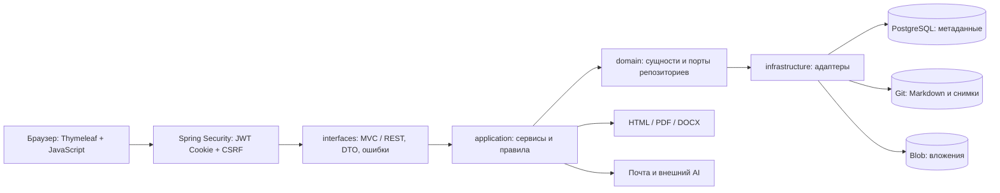
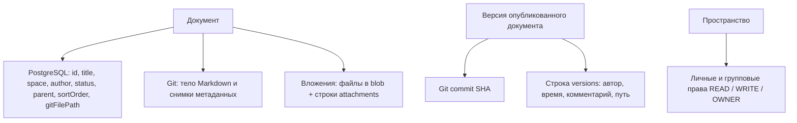
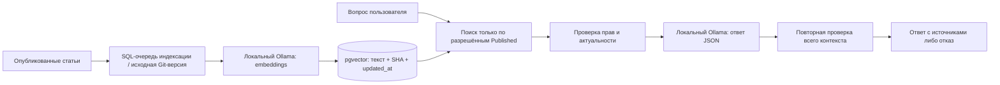

# База знаний: архитектура, выполненные исправления и план

Обновлено 26 октября 2026 года по исходному коду, OpenSpec, backlog в репозитории Docs, GitHub issues и запущенному приложению. Этот документ описывает фактическую реализацию; будущие возможности отмечены отдельно.

## Что это за проект

Это веб-база знаний для работы с документами внутри пространств: создание и редактирование Markdown, публикация черновиков, вложения, шаблоны, история версий и сравнение изменений. Администратор управляет пользователями, группами и правами. Есть поиск, журнал действий, почтовые уведомления, AI-помощник для преобразования текста и локальный RAG для вопросов по доступным опубликованным статьям.

Приложение — один Spring Boot монолит. Сервер отдаёт HTML через Thymeleaf, затем JavaScript загружает данные и выполняет действия через REST API. Редактор фактически использует textarea с Markdown-панелью и предпросмотром. Упоминания Tiptap в старых документах не соответствовали коду. Отдельного работающего SPA в папке `frontend/` нет: шаблоны и статические файлы находятся в `backend/src/main/resources`.

## Подробный стек

| Область | Фактически используется | Назначение |
| --- | --- | --- |
| Язык / сборка | Java target 17, проверено на JDK 21.0.7; Maven 3.9.9 | Компиляция и исполняемый JAR |
| Сервер | Spring Boot 3.4.4, Spring MVC, встроенный Tomcat | HTTP, REST и SSR |
| UI | Thymeleaf, обычный JavaScript и CSS, textarea | Страницы, формы, таблицы, редактор |
| Предпросмотр | локальные Marked 18.1.1 и DOMPurify 3.4.17 | Markdown → безопасный HTML в браузере |
| Безопасность | Spring Security 6.4.4, JJWT 0.11.5, BCrypt | JWT в HttpOnly Cookie, роли, права пространств, CSRF |
| Данные | PostgreSQL 18; локальная проверка 18.6 | Метаданные, пользователи, права, версии, аудит |
| Доступ к БД | Spring Data JPA / Hibernate 6.6.11.Final | Репозитории и ORM |
| Миграции | Liquibase, 36 обычных changesets + 037 с opt-in контекстом `rag` | Схема, ограничения, индексы, начальные данные |
| Тестовая БД | H2 | Java-интеграционные тесты; браузерные тесты используют настоящий PostgreSQL |
| Содержимое / версии | JGit 6.8.0.202311291450-r, локальный Git-репозиторий | Markdown-файлы, снимки и SHA коммитов |
| Вложения | файловое blob-хранилище + метаданные в PostgreSQL | Загрузка и скачивание файлов |
| Серверный Markdown / HTML | Flexmark 0.64.8, jsoup 1.23.2 | Разбор Markdown и очистка HTML |
| PDF | OpenHTMLtoPDF 1.0.10 / PDFBox, встроенные Noto Sans и Noto Sans Mono | PDF с переносимой кириллицей |
| DOCX | Apache POI 5.2.5 | Редактируемые таблицы, заголовки, списки, ссылки |
| API-документация | SpringDoc OpenAPI 2.8.6 | Swagger UI и описание контрактов |
| Вспомогательные библиотеки | Lombok 1.18.32; MapStruct 1.5.5.Final объявлен | Генерация кода; основные преобразования DTO написаны вручную |
| Тесты | JUnit 5, Mockito, Spring Boot Test, MockMvc, Node test runner, Playwright 1.59.1 / Chromium | Сервисные, интеграционные и браузерные проверки |
| Покрытие | JaCoCo 0.8.12 | Отчёт покрытия при Maven verify |
| Развёртывание | Docker Compose + `postgres:18-alpine` предусмотрены в репозитории | В этой сессии проверена локальная Java/PostgreSQL-сборка |
| AI / почта | RouterAI для переписывания; локальный Ollama + pgvector для RAG; JavaMail | Ответы по статьям, переписывание и уведомления имеют независимые настройки |

Версии взяты из `backend/pom.xml`, разрешённых зависимостей, локальных vendor-файлов и проверочного окружения. Они описывают проект, а не утверждают, что все зависимости являются последними доступными версиями.

## Архитектура



`interfaces` принимает HTTP и преобразует запросы/ответы. `application` выполняет сценарии: проверяет права, сохраняет документ, публикует его, создаёт версии и формирует экспорт. `domain` содержит сущности и интерфейсы хранения. `infrastructure` реализует эти интерфейсы через JPA, JGit и файловую систему.

Это слоистая архитектура, ориентированная на Clean Architecture, но границы не полностью изолированы: например, `domain/repository/DocumentRepository` использует Spring Data `Page`/`Pageable`, а сервисы используют Spring-транзакции и инфраструктурные настройки. Поэтому называть проект полностью независимым от фреймворка было бы неточно.

### Где находятся данные



База данных и Git решают разные задачи. SQL удобен для фильтрации, прав и связей; Git хранит содержимое и историю. Они не образуют общую атомарную транзакцию: при ошибке БД после Git-коммита код регистрирует orphan SHA. Для эксплуатации нужны согласованные резервные копии PostgreSQL, Git и blob, а не только дамп БД.

### Просмотр и сохранение

```mermaid
sequenceDiagram
    participant B as Браузер
    participant P as PageController
    participant A as REST / DocumentService
    participant DB as PostgreSQL
    participant G as Git
    B->>P: GET /documents/{id}
    P->>DB: Метаданные и доступные пространства
    P-->>B: Каркас страницы без всех деревьев
    B->>A: GET /api/documents/{id}
    A->>DB: Проверка прав и метаданные
    A->>G: Прочитать Markdown
    A-->>B: Документ для отображения
    B->>P: GET /spaces/{id}/tree при необходимости
    P-->>B: Дерево одного пространства с учётом видимости
    B->>A: PUT /api/documents/{id} + JWT Cookie + CSRF
    A->>A: Авторизация, валидация, определение изменений
    A->>G: Сохранить снимок
    A->>DB: Метаданные; версия для изменённого Published
    A-->>B: Результат сохранения
```

Создание всегда начинает документ в `Draft`. Публикация — отдельный `POST /api/documents/{id}/publish`; обычный PUT не публикует документ. Черновик виден автору или администратору при наличии доступа к пространству. Удаление переводит документ в `Deleted`; восстановление и история реализованы отдельными сценариями.

JWT хранится в HttpOnly Cookie, которую браузер прикладывает автоматически. CSRF использует читаемую Cookie `XSRF-TOKEN` и заголовок `X-XSRF-TOKEN` либо параметр формы `_csrf`. Перед API-входом клиент получает токен через `GET /login`. Сервер проверяет его на небезопасных HTTP-методах, включая login/logout.

## Что исправлено в этой работе

Ссылки на отдельные ветки и merge-коммиты технических исправлений приведены ниже. Для каждого изменения выполнялись Maven, Node и полный Playwright-прогон. В первой ветке тестов ещё оставались семь реальных ошибок фильтров; первые две ветки были опубликованы в main вместе после их исправления и зелёного полного прогона. Результаты сохранены в `tests/E2E/E2E_RESULTS.md` и архивных OpenSpec tasks.

| Исправление | Отдельная ветка | Merge в main |
| --- | --- | --- |
| Контракт и изоляция тестов | `fix/test-suite-publication-contract` | [e1c1e8e8](https://github.com/C23-501-SoftDev/Project/commit/e1c1e8e8f6c7e8a8875ab759a102674278e513c9) |
| Фильтры пространств | `fix/admin-space-filter-controls` | [f25d1024](https://github.com/C23-501-SoftDev/Project/commit/f25d10242821d102b10013bb2ce5a6fd18af324b) |
| Права на черновики и представления | `fix/document-draft-read-permissions` | [8df34516](https://github.com/C23-501-SoftDev/Project/commit/8df3451665ece44925142ad58e3c0026cd13dc52) |
| Безопасный HTML и предпросмотр | `fix/safe-markdown-html-export` | [7eba2c23](https://github.com/C23-501-SoftDev/Project/commit/7eba2c23a554a49d54558ed6031ce5cce48d29bb) |
| Переносимые шрифты PDF | `fix/pdf-portable-cyrillic-fonts` | [a37a12e3](https://github.com/C23-501-SoftDev/Project/commit/a37a12e39faba8f1abe24e8e471cdf0aea25bfe3) |
| Структура DOCX | `fix/docx-document-structure` | [997091a6](https://github.com/C23-501-SoftDev/Project/commit/997091a639e428ba7027256b6b218e1c37cb593f) |
| Независимая прокрутка (#20) | `fix/sidebar-independent-scroll` | [9b03121d](https://github.com/C23-501-SoftDev/Project/commit/9b03121d33a4be98e3f329705aa499422084dff7) |
| Загрузка деревьев по запросу (#23) | `fix/lazy-space-document-trees` | [b6a08045](https://github.com/C23-501-SoftDev/Project/commit/b6a0804575f51fe2001c4282ac6ed997b704c84c) |
| Рабочая CSRF-защита | `fix/cookie-api-csrf-protection` | [e6c766ea](https://github.com/C23-501-SoftDev/Project/commit/e6c766eab0c8daf91ebdb33090b83c80d78d80a4) |

Основные изменения:

1. Тесты приведены к реальному жизненному циклу Draft → явная публикация; удалены зависимости от чужих ID и устаревшие ожидания UI.
2. Исправлены фильтры пространств в админке: статус, динамические варианты владельца, фокус поиска и устаревшие ответы запросов.
3. Экспорт, история, diff и вложения проверяют видимость черновиков так же, как обычное чтение документа.
4. HTML очищается на сервере и в предпросмотре. Экспорт получает стили и UTF-8; PDF не обращается к URL из пользовательского Markdown.
5. PDF использует лицензированные встроенные шрифты; кириллица проверена извлечением текста, наличием embedded fonts и визуально через Poppler.
6. DOCX сохраняет таблицы, стили заголовков, вложенные списки, начальные номера, форматирование, безопасные ссылки и строки кода.
7. Дерево прокручивается независимо от основного содержимого; поиск по пространствам остаётся видимым.
8. Деревья загружаются по запросу, с дедупликацией, повтором после ошибки и сохранением drag/drop; чужие черновики не раскрываются через названия в дереве.
9. CSRF действительно проверяется сервером. Исправлены сборка заголовков и стратегия stateless JWT, которая ранее сбрасывала токен при каждом запросе.

Подробный локальный замер производительности: [сценарий и результаты](../tests/performance/README.md). На дополнительных 50 пространствах и 5000 документах медиана готовности документа изменилась с 741 до 65 мс, HTML — с 2 093 441 до 84 428 байт. Это пять последовательных открытий одним пользователем на loopback; оба варианта на этом стенде укладывались в 2 с. Для производственного SLA нужны измерения с реальной сетью и одновременными пользователями.

Проверка предыдущего этапа (25 октября): `mvn clean verify` — 127 тестов, Node — 3 проверки, Playwright на свежей PostgreSQL — 149 тестов; ошибок, пропусков и повторных запусков нет. `openspec validate --all --strict` — все 34 артефакта проходят проверку. Пять ранее реализованных изменений сверены с кодом и перенесены в архив OpenSpec с синхронизацией основных спецификаций: Git-версии, поиск пространств, шаблоны, вложения и иерархия.

## Нагрузочная приёмка на 25 пользователей — 26 октября

Оба обязательных профиля прошли: 51 пространство и 10 011 документов, включая пространство с 5001 документом. При 25 активных читателях p95 отображения статьи — 583/572 мс, максимум — 592 мс, ошибок нет. Отдельный стресс на 50 читателей также прошёл; он не определяет максимальную ёмкость системы.

Первый замер выявил задержку большого дерева: p95 7056 мс. Кеш шаблонов не помог; дерево переведено на итеративный HTML-рендерер с экранированием, сохранением прав, порядка, ссылок и drag/drop. Итоговый p95 ответа дерева при 25 читателях — 37 мс. Проверены 251 Java, 12 Node и 154 браузерных теста. [Профиль, сеть, ограничения и все три исходных отчёта](../tests/performance/results/README.md).

## Issues и оставшаяся работа

Проверены все 23 issue, доступные в репозитории на момент аудита. В GitHub оставались открыты четыре; статусы issue не являются доказательством наличия или отсутствия реализации.

| Issue | Состояние в GitHub при проверке | Состояние кода |
| --- | --- | --- |
| [#20 — Глобальный скрол для дерева](https://github.com/C23-501-SoftDev/Project/issues/20) | open, MatushaI | Исправлено отдельной веткой, есть браузерная регрессия |
| [#23 — Много пространств приводят к замедлению всей страницы, а не одной части](https://github.com/C23-501-SoftDev/Project/issues/23) | open, MatushaI | Исправлена загрузка всех деревьев, приложен замер |
| [#10 — Возможность управлять порядком следования документов в дереве](https://github.com/C23-501-SoftDev/Project/issues/10) | open, prosteyshee | Основная реализация уже была; Java-тесты порядка и новый браузерный тест переноса проходят |
| [#9 — Валидация поиска](https://github.com/C23-501-SoftDev/Project/issues/9) | open, valic865 | Валидация и функциональные тесты есть; нужна отдельная приёмка качества и производительности поиска |

Остальные 19 issue закрыты в GitHub; #18 закрыт как `not_planned`. Исправление фильтров относится к проблематике уже закрытого #17. Административные статусы issue в этой работе не менялись.

Приоритетный план:

| Приоритет | Работа | Проверяемый результат |
| --- | --- | --- |
| 1 | Дополнить оценку локального RAG реальным корпусом команды | Подтверждённое качество на рабочих вопросах; выбранные модели и пороги под конкретные документы |
| 2 | Опционально расширить автономный экспорт вложений | HTML/архив открывается вместе с файлами; PDF/DOCX безопасно включают поддерживаемые изображения без произвольных внешних запросов |
| 3 | Перенести выполненную локальную нагрузочную приёмку на целевой стенд | Профиль 25 пользователей проверен локально; отдельно подтвердить условия боевой инфраструктуры и реальной сети |
| 4 | Приёмка поиска и синхронизация issue #9/#10 | Зафиксированные сценарии, метрики и актуальные состояния задач |
| 5 | Эксплуатационная готовность | Автоматический прогон в CI, проверка Docker-сборки, восстановление согласованного набора БД/Git/blob, реальная интеграционная проверка SMTP/AI |

Текущий HTML сохраняет относительные ссылки на вложения, но не упаковывает их в автономный архив. PDF намеренно не загружает внешние изображения; DOCX сохраняет alt-текст, но не встраивает картинки. Кириллица и латиница проверены; полное покрытие Unicode/emoji не обещается.

## RAG: локальная реализация

Итоговая проверка 26 октября: 246 Java-тестов, 3 Node-проверки, 154 Playwright-теста; ошибок и пропусков нет. Реальный локальный RAG: 24/24 содержательных ответа с ожидаемыми источниками, 6/6 корректных отказов; p95 около 2 секунд на небольшом синтетическом корпусе. [Все отчёты, методика и границы результата](../tests/rag/results/README.md).

26 октября добавлен отдельный локальный RAG через Ollama: Qwen3 Embedding 0.6B (1024 измерения), Qwen3 4B для ответов, PostgreSQL 18 / pgvector 0.8.7. Внешний RouterAI остаётся только у прежнего помощника переписывания. На проверочном стенде он выключен.

[Подробная инструкция запуска, API, ограничения и откат](RAG_LOCAL.md). [Набор 30 вопросов и методика реальной оценки моделей](../tests/rag/README.md). По умолчанию RAG выключен; схема создаётся только явным Liquibase-контекстом `rag`.



Страница `/ask` показывает ответ и источники. API принимает вопрос и необязательные ID пространств. Ссылки формирует сервер из проверенных документов; произвольный HTML модели не исполняется. При отзыве доступа или изменении любого источника во время генерации ответ целиком отклоняется. Статьи без сведений для ответа приводят к `insufficientEvidence`.

Индексация имеет долговечные задания, аренду, повторные попытки, лимиты и восстановление после перезапуска. Первые публикации без строки `versions` получают неизменяемую Git-версию перед индексацией. Черновики и удалённые статьи исключаются; смена версии или `updated_at` немедленно исключает устаревшие фрагменты.

Модели работают локально с отключёнными облачными функциями. Реализация не включает OCR, индексацию вложений, веб-поиск и автоматическое изменение документов. Квота пользовательских запросов хранится в одном Java-процессе; для нескольких реплик нужен общий limiter. Синтетическая оценка не заменяет приёмку на реальных документах команды.

## Паттерны, которые полезно понимать при защите проекта

Dependency Injection используется через конструкторы Spring-компонентов, Repository — через доменные порты и адаптеры хранения, событийная модель — в уведомлениях после commit. `User.create()` и `Document.create()` — статические фабричные методы; это не автоматически GoF Factory Method с полиморфным создателем. Spring-сервисы по умолчанию имеют singleton scope, но это отличается от ручного `static getInstance()`. Явной Abstract Factory в текущем коде не обнаружено.

## Как ориентироваться в репозитории

- [`backend/pom.xml`](../backend/pom.xml) — зависимости и сборка.
- [`backend/src/main/java/com/knowledgebase`](../backend/src/main/java/com/knowledgebase) — четыре слоя приложения.
- [`backend/src/main/resources/templates`](../backend/src/main/resources/templates) и [`static`](../backend/src/main/resources/static) — фактический frontend.
- [`BACKTRACKER.md`](../BACKTRACKER.md) — страницы и HTTP-контракты.
- [`openspec/feature-registry.json`](../openspec/feature-registry.json) — актуальный индекс возможностей; [`openspec/specs`](../openspec/specs) — нормативные требования.
- [`openspec/changes/archive`](../openspec/changes/archive) — завершённые изменения с задачами и результатами проверки.
- [`openspec/quality-gates.md`](../openspec/quality-gates.md) — команды проверки.
- [`tests/E2E/E2E_RESULTS.md`](../tests/E2E/E2E_RESULTS.md) — фактические результаты полных прогонов.

Локальные проверочные стенды: обычное приложение `http://127.0.0.1:18080` и RAG `http://127.0.0.1:18081/ask`, разные тестовые базы PostgreSQL на `127.0.0.1:55433`, отдельные Git/blob-каталоги. Ollama работает на `127.0.0.1:11434` с `OLLAMA_NO_CLOUD=1`. Внешний AI и почта отключены. Секреты, веса моделей и временные данные не коммитились.
