# Локальный RAG: запуск, проверка и эксплуатация

Для самостоятельного запуска на текущем Mac используйте [постоянный локальный стек](LOCAL_SETUP_RU.md): `scripts/local/stack.sh start` поднимает PostgreSQL, Ollama и приложение из `.local/`; `stop` сохраняет статьи, версии, вложения и модели. Ручные команды ниже нужны для настройки отдельного окружения и диагностики. Не запускайте второй `ollama serve` на том же порту, если стек уже работает.

Реализация от 2026-10-26 отвечает по опубликованным статьям, которые пользователь может читать. Выбран локальный Ollama: вопросы и фрагменты статей не передаются внешнему AI. Старый AI-помощник редактирования текста имеет отдельные настройки `AI_*`; для полностью локального стенда оставьте `AI_ENABLED=false`.

## Компоненты и данные

```mermaid
flowchart LR
    D["Опубликованные статьи: SQL + Git"] --> P["Периодическая сверка и baseline первой версии"]
    P --> J["Долговечные SQL-задания с арендой"]
    J --> C["Фрагменты текста + SHA + updated_at"]
    C --> E["Ollama: Qwen3 Embedding"]
    E --> V[("PostgreSQL + pgvector")]
    Q["Вопрос + пользователь"] --> R["Точный cosine search в разрешённых статьях"]
    V --> R
    R --> B["До 8 фрагментов, до 2 из одной статьи"]
    B --> A["Проверка прав и версии"]
    A --> L["Ollama: Qwen3, ответ JSON"]
    L --> F["Повторная проверка всех использованных источников"]
    F --> UI["Ответ и проверенные ссылки либо отказ"]
```



Поиск не использует черновики, удалённые статьи и удалённые пространства. Права не копируются в векторный индекс: они проверяются по текущим данным. Если во время генерации изменились права, версия или метаданные любого использованного источника, весь ответ отклоняется с HTTP409 — даже когда модель не процитировала этот источник.

Обычная первая публикация раньше не создавала строку `versions`. Включённый индексатор добавляет для таких статей настоящий неизменяемый Git snapshot и запись версии с комментарием `RAG baseline for published document`. Текст статьи сохраняется прежним. SQL-блокировка документа используется также редактором и восстановлением версии, чтобы чтение исходной версии не пересекалось с записью Git. Сам RAG не редактирует статьи.

`rag_chunks` хранит текст, модель, размерность, SHA, номер фрагмента, `source_updated_at` и вектор. Задания `rag_index_jobs` восстанавливаются после перезапуска. Аренда — 5 минут с продлением перед пакетами; максимум 5 попыток с задержкой. Результат заменяется атомарно и только при совпадении владельца аренды, текущего SHA и `updated_at`. Удалённые/устаревшие строки исключаются из поиска сразу, физическая очистка выполняется фоновым проходом.

## Локальное окружение

Проверяемые версии: PostgreSQL18.6, pgvector0.8.7, Ollama0.40.11. Используйте JDK17/21 и Maven, как для основного приложения. Расширение pgvector устанавливается на сервер PostgreSQL; миграция требует права `CREATE EXTENSION`, либо администратор заранее создаёт `vector` в целевой БД.

Модели:

- `qwen3-embedding:0.6b`, 1024 измерения — векторизация;
- `qwen3:4b` — ответы, thinking выключен, temperature0, структурированный JSON.

Официальные источники: [модели Qwen3 Embedding](https://ollama.com/library/qwen3-embedding), [Qwen3 4B](https://ollama.com/library/qwen3:4b), [API embeddings](https://docs.ollama.com/api/embed), [API chat](https://docs.ollama.com/api/chat), [отключение облачных функций](https://docs.ollama.com/faq), [pgvector](https://github.com/pgvector/pgvector).

В отдельном терминале запустите локальный Ollama:

```sh
OLLAMA_HOST=127.0.0.1:11434 OLLAMA_NO_CLOUD=1 ollama serve
```

Затем загрузите модели. Это скачивание весов; документы приложения в этих запросах не участвуют.

```sh
ollama pull qwen3-embedding:0.6b
ollama pull qwen3:4b
```

Адаптер приложения допускает только loopback-адреса и имена `ollama` / `host.docker.internal` для локального Docker. Внешние URL, перенаправления, системный HTTP proxy и имена cloud-моделей запрещены. На macOS нативный Ollama позволяет использовать GPU; Docker-вариант здесь не проверялся.

## Миграция и включение

По умолчанию `RAG_ENABLED=false`. Существующее приложение запускается без Ollama и pgvector. Новая миграция037 имеет явный контекст `@rag`, поэтому не выполняется при обычном старте и не затрагивает H2.

1. Установите pgvector на PostgreSQL и настройте существующие `DB_URL`, `DB_USERNAME`, `DB_PASSWORD`, Git/blob-пути.
2. Соберите `backend` командой `mvn clean verify`.
3. Для начальной индексации запустите приложение с параметрами:

```sh
export AI_ENABLED=false
export RAG_ENABLED=true
export RAG_SERVING_ENABLED=false
export RAG_BASE_URL=http://127.0.0.1:11434
export SPRING_LIQUIBASE_CONTEXTS=rag
java -jar backend/target/knowledge-base-backend-1.0.0-SNAPSHOT.jar
```

4. Проверьте очередь и реальную оценку качества по [методике](../tests/rag/README.md). Переход в `DONE` показывает успешную индексацию, `FAILED` требует разбора. Проверьте отсутствие публикаций без версии/chunks и дождитесь обработки всего первоначального набора.
5. После успешной приёмки перезапустите с `RAG_SERVING_ENABLED=true`. Страница вопросов: `/ask`.

`RAG_ENABLED=false` выключает и ответы, и фоновые вызовы модели. `RAG_SERVING_ENABLED=false` выключает ответы, сохраняя индексацию. `RAG_INDEXING_ENABLED=false` останавливает индексатор; поиск продолжает исключать устаревшие источники, поэтому обновлённая статья временно не попадёт в ответ.

## Контракты API

JWT Cookie и CSRF обязательны, как для остальных изменяющих API. Перед API-входом получите CSRF-cookie через `GET /login`.

| Метод и путь | Контракт |
| --- | --- |
| `GET /api/ai/rag/status` | `{enabled}` — конфигурация serving и доступность схемы; не проверка качества ответов или наличия моделей |
| `POST /api/ai/ask` | `{question, spaceIds?}`; вопрос1–2000 символов, до20 положительных ID пространств |
| `GET /ask` | SSR-страница вопросов с выбором пространств |

Ответ: `{answer, sources, insufficientEvidence, requestId}`. Источник: `{documentId, title, url, versionSha, chunkIndex}`. Ссылки создаёт сервер; модель выбирает только числовые ID переданного контекста. UI выводит ответ как текст, не исполняет HTML. Ответы API имеют `Cache-Control: no-store`.

Для составного вопроса модель объединяет и сравнивает подтверждённые сведения нескольких статей и указывает все использованные источники. Полный ответ не обязан находиться в одной статье. Если подтверждена полезная часть вопроса, ответ содержит её и явно обозначает недостающие сведения; `insufficientEvidence=false` в таком случае не означает, что известны все детали. Полностью неподтверждённый вопрос получает отказ. Противоречия источников должны быть обозначены, а выводы отделены от прямых фактов; модель не должна придумывать причинные связи или переносить правила между разными объектами.

Внутренний контракт ответа Ollama фиксирует порядок полей JSON Schema: `answer`, затем `sourceIds`, затем `insufficientEvidence`. Порядок задаётся явно и сохраняется между запусками JVM; допустимые ID источников сортируются. При диагностических повторах на Qwen3 4B изменение порядка полей влияло на результат constrained decoding: модель могла сначала выбрать источники, а затем вернуть противоречащий им отказ. Поэтому перестановка этих полей требует повторной проверки качества, хотя для обычного JSON порядок ключей семантически незначим. Парсер дополнительно отклоняет неизвестные и повторяющиеся ID, лишние поля, противоречивое сочетание флага отказа и источников, некорректный JSON и незавершённую генерацию.

Ошибки: 400 — валидация, 409 — изменились источники/права, 429 — квота, 502 — модель недоступна или нарушила контракт, 503 — функция выключена либо индекс недоступен. Недостаток подтверждённых сведений возвращается успешным ответом с `insufficientEvidence=true` и пустыми источниками. Детали ответов провайдера и пользовательский текст не включаются в ошибки/штатные RAG-логи.

## Ограничения ресурсов и настройка

| Переменная | По умолчанию | Назначение |
| --- | --- | --- |
| `RAG_EMBEDDING_MODEL` / `RAG_EMBEDDING_DIMENSIONS` | qwen3-embedding:0.6b /1024 | Модель и размер вектора |
| `RAG_GENERATION_MODEL` | qwen3:4b | Локальная модель ответа |
| `RAG_TIMEOUT_SECONDS` | 90 | Общий предел одного вызова Ollama |
| `RAG_CONTEXT_TOKENS` / `RAG_MAX_CONTEXT_CHARS` | 8192 /12000 | Окно модели и суммарный текст источников |
| `RAG_MAX_OUTPUT_TOKENS` | 600 | Максимальный ответ модели |
| `RAG_TOP_K` / `RAG_MINIMUM_SCORE` | 8 /0.3 | Число фрагментов и порог cosine similarity |
| `RAG_MAX_CHUNKS_PER_DOCUMENT` | 2 | Максимум фрагментов одной статьи до общего cutoff; допустимо 1–20 |
| `RAG_CHUNK_CHARS` / `RAG_CHUNK_OVERLAP` | 1200 /150 | Разбиение статей |
| `RAG_REQUESTS_PER_MINUTE` | 6 | Запросов на пользователя за минутное окно |
| `RAG_DAILY_REQUESTS` | 100 | Общий лимит запросов в сутки UTC на процесс |
| `RAG_DAILY_EMBEDDING_CHARACTERS` | 1000000 | Суточный SQL-бюджет текста индексации |
| `RAG_INDEXING_BATCH_SIZE` | 10 | Максимум заданий за проход |
| `RAG_MAX_DOCUMENT_CHARS` | 100000 | Предел статьи для индексации без молчаливого обрезания |
| `RAG_INDEXING_DELAY_MS` | 15000 | Пауза между проходами |

Одновременно допускаются два запроса ответа. Квоты запросов находятся в памяти одного процесса и сбрасываются после перезапуска; SQL-бюджет индексации сохраняется. Для нескольких экземпляров приложения нужен общий limiter. Нельзя представлять эти ограничения как денежный billing: внешних платных API нет, стоимость локальной энергии/оборудования не измерялась.

При изменении модели/размерности очередь перестраивает индекс; результаты старой модели не смешиваются с новой. Используйте фиксированные model tags и записывайте digest при обновлении весов. При обновлении весов с прежним тегом задайте новое локальное имя модели (например, через `ollama cp`) и измените `RAG_EMBEDDING_MODEL`: один mutable tag сам по себе не идентифицирует новые веса. Допустимый overlap ограничен половиной chunk, чтобы объём промежуточного текста не разрастался многократно. Исходные 30 вопросов и расширенный набор из 40 вопросов дополняют тесты, но не доказывает качество на любых документах и не гарантирует отсутствие галлюцинаций.

Поиск использует точное cosine distance по подходящим векторам, без ANN-индекса. Это сохраняет полноту ранжирования внутри выбранного набора, но стоимость поиска растёт с числом фрагментов. Текущий сервис сначала получает доступные документы и повторяет SQL-проверки пространства/прав для каждой статьи; затем передаёт ID в `IN`. На большом корпусе это даёт N+1-запросы и может упереться в лимит параметров PostgreSQL. Перед масштабированием следует перенести фильтр доступа в SQL, сократить повторные проверки пространств и отдельно измерить нагрузку. Финальную проверку прав всех переданных модели источников при этом нужно сохранить.

## Недоверенные инструкции и границы проверки

Лимит на статью применяется в SQL до общего ограничения количества результатов: длинная статья не занимает все восемь мест своими похожими фрагментами. Внутри и между статьями сохраняется ранжирование по сходству. Контекст дополнительно ограничен суммарным числом символов. Это расширяет охват статей, но не гарантирует, что найдены все сведения корпуса: при необходимости большого числа деталей одной статьи можно изменить `RAG_MAX_CHUNKS_PER_DOCUMENT`. Изменение этих настроек не требует переиндексации.

Заголовки и текст статей передаются как данные, а не команды. Поле вопроса также не может задавать новые правила поведения. Промпт требует отказа, если вопрос просит выполнить инструкцию из статьи, раскрыть посторонние данные или повторить такую инструкцию вместо фактического ответа. Для ответа необходим конкретный подтверждающий факт; совпадения темы или названия проекта недостаточно.

Диагностические прогоны выявили два класса регрессий: содержательный ответ при отсутствии нужного факта и повтор недоверенной команды из статьи. Эти случаи включены в синтетический набор вместе с маркером `RAG-INJECTION-CANARY`; после изменения промпта или порядка полей требуется полный повтор оценки по [методике](../tests/rag/README.md). Результат конкретного запуска фиксируется отдельно, а не выводится из наличия тестового кода.

Промпт и успешные проверки известных атак не дают универсальной гарантии защиты от prompt injection или галлюцинаций. Жёсткие ограничения приложения отделены от поведения модели: SQL/сервис определяют доступные источники, сервер проверяет цитаты, UI отображает обычный текст, а адаптер не предоставляет модели инструменты выполнения команд и сетевых запросов. Неправильный смысловой вывод по доступной статье всё ещё возможен; существенные ответы следует сверять с источником.

## Диагностика и откат

```sql
SELECT state, count(*) FROM rag_index_jobs GROUP BY state;
SELECT document_id, state, attempts, last_error FROM rag_index_jobs WHERE state = 'FAILED';
```

После устранения причины оператор может вернуть конкретное задание в очередь, указав точный документ, модель и размерность:

```sql
-- Замените 123 на ID проверенного задания.
UPDATE rag_index_jobs
SET state = 'PENDING', attempts = 0, available_at = CURRENT_TIMESTAMP,
    lease_until = NULL, lease_token = NULL, last_error = NULL
WHERE document_id = 123 AND embedding_model = 'qwen3-embedding:0.6b'
  AND embedding_dimensions = 1024 AND state = 'FAILED';
```
 Не сбрасывайте все попытки автоматически: это отменяет защиту от бесконечного расхода ресурсов. Статьи сверх установленного лимита следует разделить или осознанно увеличить лимит.

Откат serving: `RAG_SERVING_ENABLED=false`. Полное выключение: `RAG_ENABLED=false`. Исходные статьи, история и вложения сохраняются; векторный индекс можно восстановить. Не удаляйте расширение `vector`, если его использует другой компонент этой же БД.

## Проверенный результат

[Отчёты реальной оценки моделей и полной регрессии за 26 октября 2026](../tests/rag/results/README.md): после расширения контекста и промпта 10/10 вопросов по нескольким статьям содержат все требуемые факты и цитаты, против 7/10 на прежней версии. В трёх старых ответах факты были верны, но отсутствовала вторая подтверждающая ссылка. Исходные 24/24 ответа и 6/6 отказов сохранены; все 40 запросов успешны, неправильных цитат и injection-маркера нет. Все ответы просмотрены вручную; у отдельных ответов остаются неловкие формулировки и избыточные подробности.

На этом синтетическом корпусе полный запрос занимает p50 2458 мс и p95 4146 мс; у baseline было 1700 и 3818 мс. Это измерение локального стенда, а не производственный SLA. Регрессия: 281 Java, 12 Node, 7 Python и 158 Playwright — без ошибок и пропусков. Исходные отчёты, включая неудачные, сохранены.
